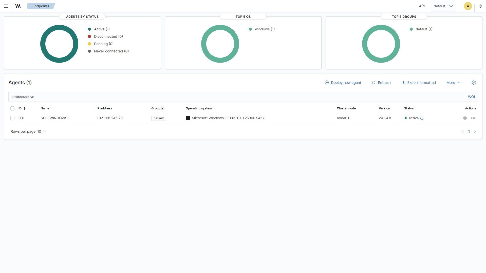
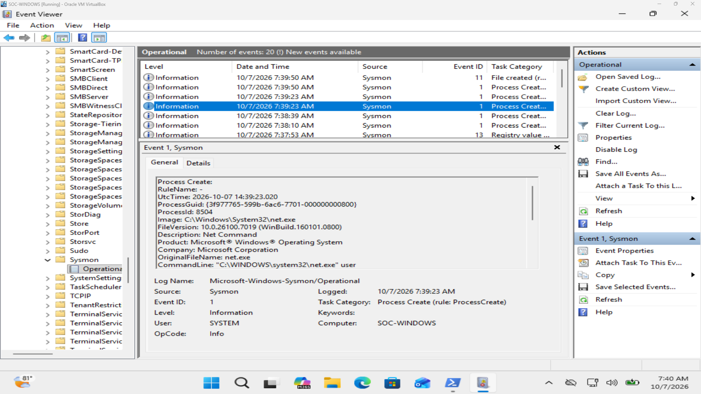
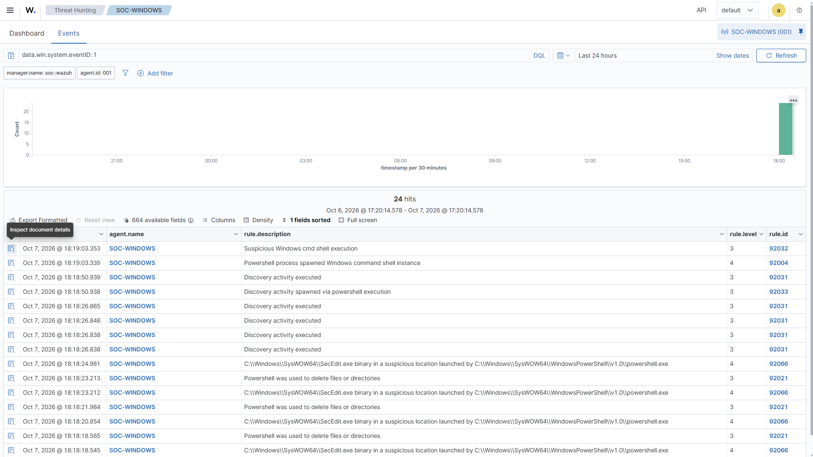
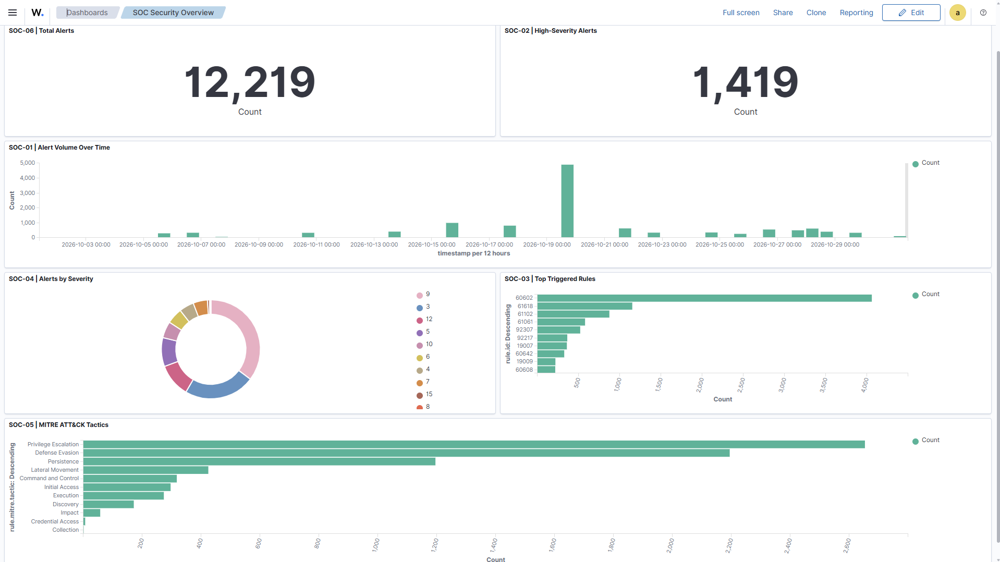

# SOC Home Lab

**Security monitoring, detection engineering, incident investigation, and operational dashboards with Wazuh, Sysmon, Windows 11, and Kali Linux.**

This repository documents an isolated, authorized Security Operations Center (SOC) home lab. It demonstrates a complete workflow: collect Windows telemetry, develop and test Wazuh detections, investigate controlled adversary simulations, validate recovery, and visualize results using saved SOC dashboards.

## Project at a Glance

| Area | Documented result |
|---|---|
| Infrastructure | VirtualBox lab, Wazuh all-in-one, Windows 11 agent, Sysmon integration |
| Detection engineering | **8 exercises (D001–D008)** with tests, rule logic, and limitations |
| Incident response | **6 investigations (INC-001–INC-006)** with forensic evidence and cleanup |
| Monitoring | **2 custom Wazuh dashboards, 13 saved panels** |
| Evidence | **59 screenshots** illustrating telemetry, detection, investigations, and monitoring |
| ATT&CK | Tactics and techniques mapped to observed lab behaviors |

## Explore the Project

- [Lab Architecture](architecture/lab-overview.md)
- [Detection Engineering](detections/)
- [Incident Investigations](incidents/)
- [SOC Monitoring Dashboards](dashboards/README.md)
- [MITRE ATT&CK Mapping](mitre-attack/README.md)
- [Lessons Learned](lessons-learned/README.md)

## Lab Architecture

The lab runs on Oracle VirtualBox. A **Host-Only network** isolates the test systems; NAT is used separately for internet connectivity when needed.

| System | Role | Lab IP |
|---|---|---|
| Windows host | Virtualization management | `192.168.245.1` |
| Wazuh / Ubuntu Server | SIEM manager, indexer, dashboard | `192.168.245.10` |
| `SOC-WINDOWS` / Windows 11 Pro | Monitored endpoint (Wazuh agent `001`) | `192.168.245.20` |
| Kali Linux | Authorized test activity | `192.168.245.30` |

```text
Kali test activity --> Windows 11 --> Security/System logs + Sysmon
                          |                      |
                          +------ Wazuh Agent ---+
                                      |
                                      v
                           Wazuh Manager/Indexer
                                      |
                                      v
                        Alerts, investigations, dashboards
```

[Detailed architecture](architecture/lab-overview.md)

## Telemetry and Validation

Collected evidence includes Windows Security and System events, Sysmon process telemetry, selected SMB audit events, and correlated Wazuh alerts. Notable event IDs include **4625** (failed logon), **4720** (account creation), **4732** (local group addition), **5145** (file-share access check), and **7045** (new Windows service).

Initial integration was verified by running `net user` on the Windows endpoint, observing Sysmon **Event ID 1**, and confirming that matching events reached Wazuh.

<details>
<summary>Initial telemetry verification screenshots</summary>


*Wazuh manager and dashboard running.*



*Windows endpoint successfully connected to Wazuh.*



*Sysmon Event ID 1 records the test command.*



*Sysmon process telemetry appears in Wazuh.*

</details>

## Detection Engineering

Eight documented exercises include the rule design, relevant telemetry, positive/negative testing where performed, and practical limitations.

| ID | Focus | Documentation |
|---|---|---|
| D001 | `whoami` execution and user discovery | [Report](detections/D001-whoami-execution.md) |
| D002 | Encoded PowerShell command execution | [Report](detections/D002-encoded-powershell.md) |
| D003 | Repeated failed Windows logons | [Report](detections/D003-repeated-failed-logons.md) |
| D004 | Suspicious scripting host–PowerShell process relationship | [Report](detections/D004-scripting-host-powershell.md) |
| D005 | Suspicious scheduled task creation | [Report](detections/D005-suspicious-scheduled-task.md) |
| D006 | Registry Run key persistence | [Report](detections/D006-registry-persistence.md) |
| D007 | PowerShell network connection behavior | [Report](detections/D007-powershell-network-connection.md) |
| D008 | SMB bulk document access (Wazuh rules `100170` / `100171`) | [Report](detections/D008-smb-bulk-document-access.md) |

**D008 example:** After collecting Windows Event **5145**, the lab validated a rule correlation for repeated document access requests. A controlled two-file test did not trigger the bulk rule; a ten-file test produced a Level 8 alert from `100171`. An access-check event alone does **not** establish a completed file transfer.

## Incident Investigations

Six investigations reconstruct the activity, explain the observed evidence, and document remediation and verification.

| Incident | Scenario | Report |
|---|---|---|
| INC-001 | Multiple failed logins | [Investigation](incidents/INC-001-failed-logins/investigation.md) |
| INC-002 | Suspicious PowerShell execution and process correlation | [Investigation](incidents/INC-002-powershell/investigation.md) |
| INC-003 | Local administrator account creation and removal | [Investigation](incidents/INC-003-admin-account/investigation.md) |
| INC-004 | SMB file access and telemetry coverage gap | [Investigation](incidents/INC-004-smb-file-access/investigation.md) |
| INC-005 | Windows service persistence | [Investigation](incidents/INC-005-service-persistence/investigation.md) |
| INC-006 | Multi-stage intrusion: RDP, service abuse, account changes, registry hive copies, SMB | [Investigation](incidents/INC-006-multi-stage-intrusion/investigation.md) |

**Featured investigation — [INC-006](incidents/INC-006-multi-stage-intrusion/investigation.md):** Reconstructed the path from full-port reconnaissance and RDP entry to SYSTEM-context service execution, administrative account changes, credential-store copy acquisition, SMB transfers, and recovery. This demonstrated **registry hive acquisition**, not credential-hash extraction or an interactive SYSTEM shell.

## SOC Monitoring Dashboards

Two saved dashboards use the `wazuh-alerts-*` data view to turn indexed alerts into practical monitoring views.

| Dashboard | Panels |
|---|---|
| **SOC Security Overview** | Total and high-severity alerts, volume over time, most frequent rules, severity levels, MITRE ATT&CK tactics |
| **Authentication & Endpoint Activity** | Failed logons, RDP brute-force alerts, account creation, group changes, PowerShell detections, new services, SMB bulk-access alerts |



*SOC Security Overview — saved Wazuh monitoring dashboard.*

[Dashboard 1 and 2: documentation, DQL filters, screenshots, and interpretation](dashboards/README.md)

Dashboard counts depend on the selected time range and retention. An alert count is not a count of distinct incidents, and the absence of an indexed alert is not proof that an event did not occur.

## Skills Demonstrated

- Windows security auditing and Sysmon-based process correlation
- Wazuh deployment, agent configuration, alert analysis, and rule validation
- Positive/negative detection testing and documenting coverage gaps
- Evidence-based SOC investigation, timeline reconstruction, and recovery verification
- MITRE ATT&CK technique mapping
- Building Wazuh security monitoring visualizations

## Scope and Safety

All attack simulations were authorized and performed inside an isolated lab with test accounts and synthetic data. The public-facing reports focus on detection and defensive analysis; registry hive exports, account secrets, password lists, and sensitive payloads are not part of the published evidence.

**Next:** [MITRE ATT&CK mapping](mitre-attack/README.md) · [Lessons learned](lessons-learned/README.md)
