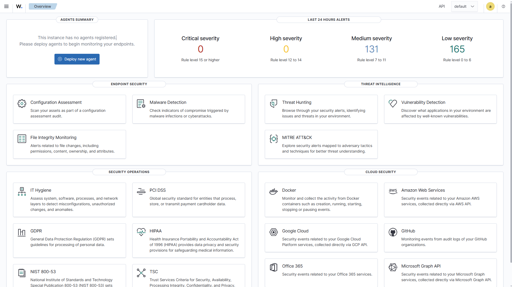

# SOC Home Lab

A practical Security Operations Center home lab focused on security monitoring, Windows telemetry, detection engineering, threat hunting, and incident response using Wazuh, Sysmon, Windows 11, and Kali Linux.

---

## Project Objectives

The goal of this project is to build a realistic SOC environment and gain hands-on experience with:

- SIEM deployment and administration
- Windows security monitoring
- Sysmon telemetry
- Log collection and analysis
- Threat hunting
- Detection engineering
- Alert investigation
- Incident response
- MITRE ATT&CK mapping

---

## Lab Architecture

The environment is built using VirtualBox and contains:

| System | Role | IP Address |
|---|---|---|
| Windows Host | Lab Management | 192.168.245.1 |
| Wazuh Server | SIEM / XDR | 192.168.245.10 |
| Windows 11 Endpoint | Monitored Endpoint | 192.168.245.20 |
| Kali Linux | Adversary Simulation | 192.168.245.30 |

The lab uses a dedicated Host-Only network for internal security testing while NAT is used separately for Internet access.

Full architecture documentation:

[View Lab Architecture](architecture/lab-overview.md)

---

## Technologies

- Wazuh SIEM / XDR
- Windows 11 Pro
- Sysmon
- Ubuntu Server
- VirtualBox
- Kali Linux
- Windows Event Logs
- MITRE ATT&CK

---

## Current Progress

- [x] VirtualBox lab network configured
- [x] Ubuntu Server deployed
- [x] Wazuh All-in-One server installed
- [x] Wazuh Dashboard configured
- [x] Windows 11 endpoint deployed
- [x] Static lab IP addresses configured
- [x] Wazuh Agent installed
- [x] Windows endpoint connected to Wazuh
- [x] Sysmon installed
- [x] Sysmon Process Creation telemetry verified
- [x] Sysmon logs forwarded to Wazuh
- [x] Sysmon Event ID 1 visible in Threat Hunting
- [ ] Custom detection rules
- [ ] Authentication attack detections
- [ ] PowerShell detection
- [ ] Persistence detection
- [ ] Incident investigations
- [ ] MITRE ATT&CK mapping
- [ ] Kali Linux adversary simulation

---

## Wazuh Deployment

The Wazuh server was deployed on Ubuntu Server and configured as an all-in-one installation including:

- Wazuh Manager
- Wazuh Indexer
- Wazuh Dashboard



---

## Windows Endpoint Monitoring

A Windows 11 Pro endpoint named `SOC-WINDOWS` was deployed and connected to the Wazuh Manager using the Wazuh Agent.

Endpoint:

```text
Hostname: SOC-WINDOWS
IP: 192.168.245.20
Wazuh Manager: 192.168.245.10
