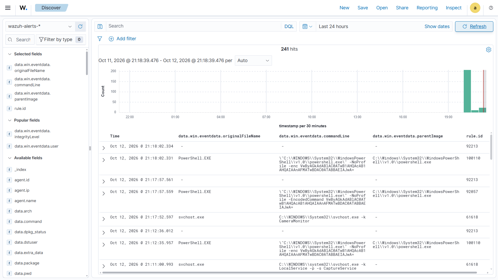

# D002 — Encoded PowerShell Command Detection

## Objective

Detect PowerShell processes executed using encoded command-line arguments such as `-EncodedCommand` or `-enc`.

Encoded PowerShell commands may be used by administrators and automation tools, but they are also commonly used to obscure command content during malicious execution.

---

## Data Source

- Sysmon
- Event ID 1 — Process Creation

---

## MITRE ATT&CK

- T1059.001 — Command and Scripting Interpreter: PowerShell

---

## Detection Logic

The detection identifies Sysmon Process Creation events where:

1. The original executable filename is `PowerShell.EXE`.
2. The PowerShell command line contains either `-EncodedCommand` or `-enc`.

```text
Sysmon Event ID 1
AND
OriginalFileName = PowerShell.EXE
AND
CommandLine contains:
    -EncodedCommand
    OR
    -enc
```

The detection combines process identity with command-line behavior instead of alerting on every PowerShell execution.

This reduces noise from normal PowerShell usage such as:

```powershell
powershell.exe -NoProfile -Command "Get-Date"
```

---

## Wazuh Rule

```xml
<rule id="100110" level="7">
  <if_group>sysmon_event1</if_group>

  <field name="win.eventdata.originalFileName" type="pcre2">(?i)^powershell\.exe$</field>

  <field name="win.eventdata.commandLine" type="pcre2">(?i)(?:^|\s)-(?:encodedcommand|enc)(?:\s|$)</field>

  <description>PowerShell encoded command execution detected</description>

  <mitre>
    <id>T1059.001</id>
  </mitre>
</rule>
```

---

## Detection Fields

The following fields are used directly by the detection:

```text
Sysmon Event ID
OriginalFileName
CommandLine
```

Additional fields are retained as investigation context:

```text
Image
ParentImage
User
IntegrityLevel
CurrentDirectory
ProcessId
ParentProcessId
ProcessGuid
```

---

## Test Payload

A harmless PowerShell command was used for testing:

```powershell
$cmd = "Write-Output 'SOC-LAB'"
```

The command was converted to Base64 using PowerShell's Unicode encoding:

```powershell
$encoded = [Convert]::ToBase64String(
    [Text.Encoding]::Unicode.GetBytes($cmd)
)
```

No malicious payload was used during testing.

---

## Positive Test 1 — EncodedCommand

The following command was executed:

```powershell
powershell.exe -NoProfile -EncodedCommand $encoded
```

Expected result:

```text
Rule 100110 should trigger.
```

Observed result:

```text
Rule 100110 triggered successfully.
```

The decoded command produced:

```text
SOC-LAB
```

---

## Positive Test 2 — Short Parameter

PowerShell also supports abbreviated command-line parameters.

The following command was tested:

```powershell
powershell.exe -NoProfile -enc $encoded
```

Expected result:

```text
Rule 100110 should trigger.
```

Observed result:

```text
Rule 100110 triggered successfully.
```

This confirms that the detection handles both:

```text
-EncodedCommand
-enc
```

---

## Negative Test

A normal PowerShell command was executed:

```powershell
powershell.exe -NoProfile -Command "Get-Date"
```

Expected result:

```text
Rule 100110 should not trigger.
```

Observed result:

```text
No Rule 100110 alert was generated.
```

A separate built-in Wazuh rule generated an alert for the PowerShell activity, but the custom encoded-command detection did not match.

This confirms that Rule `100110` does not alert on every PowerShell execution.

---

## Validation Results

| Test | Expected | Result |
|---|---|---|
| `-EncodedCommand` | Trigger | Passed |
| `-enc` | Trigger | Passed |
| Normal `-Command "Get-Date"` | No trigger | Passed |

---

## Detection Evidence

The encoded PowerShell executions were successfully detected by custom Wazuh Rule `100110`.



---

## Investigation Context

When this alert is generated, the analyst should review:

### Command Line

Determine what was supplied to the encoded PowerShell execution.

```text
data.win.eventdata.commandLine
```

### Parent Process

Identify which process launched PowerShell.

```text
data.win.eventdata.parentImage
```

Examples requiring additional investigation may include unusual application-to-PowerShell process relationships.

### User

Identify the account responsible for the execution.

```text
data.win.eventdata.user
```

### Integrity Level

Determine whether PowerShell was running with standard, elevated, or SYSTEM privileges.

```text
data.win.eventdata.integrityLevel
```

### Process Lineage

Review:

```text
ProcessId
ParentProcessId
ProcessGuid
ParentProcessGuid
```

to reconstruct the execution chain and identify related processes.

---

## False Positives

Encoded PowerShell is not inherently malicious.

Legitimate use cases may include:

- Administrative automation
- Software deployment systems
- Configuration management
- Enterprise management tools
- Security testing
- Authorized PowerShell scripts

The alert should therefore be investigated in context rather than treated automatically as malicious activity.

---

## Analyst Interpretation

The detection indicates that PowerShell was executed using an encoded command-line argument.

This behavior can reduce command readability and may be used to obscure execution content.

An analyst should determine:

```text
Who executed it?
What was encoded?
What process launched PowerShell?
Was the execution expected?
Was PowerShell elevated?
What occurred immediately before and after the event?
Are there related alerts on the endpoint?
```

A detection alone does not establish malicious intent.

---

## Detection Design Notes

A rule matching only:

```text
OriginalFileName = PowerShell.EXE
```

would create excessive noise because PowerShell is widely used for legitimate administration.

Adding the command-line condition:

```text
-EncodedCommand
OR
-enc
```

provides more behavioral context and improves detection precision.

The parent process was intentionally not included as a mandatory detection condition because PowerShell may be launched through many different legitimate or malicious parent processes.

Instead, `ParentImage` is retained for investigation and future detection enrichment.

---

## Lessons Learned

- Process identity alone is often insufficient for useful detection.
- Command-line arguments provide important behavioral context.
- Multiple conditions can significantly improve detection precision.
- Detection logic should account for common command-line variations.
- Positive and negative testing are both required.
- An event may trigger other built-in SIEM rules even when a specific custom rule does not match.
- Parent processes and user context are valuable for investigation without necessarily being required detection conditions.
- Encoded PowerShell activity warrants investigation but does not automatically indicate malicious behavior.