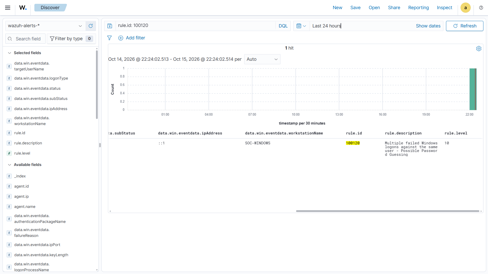
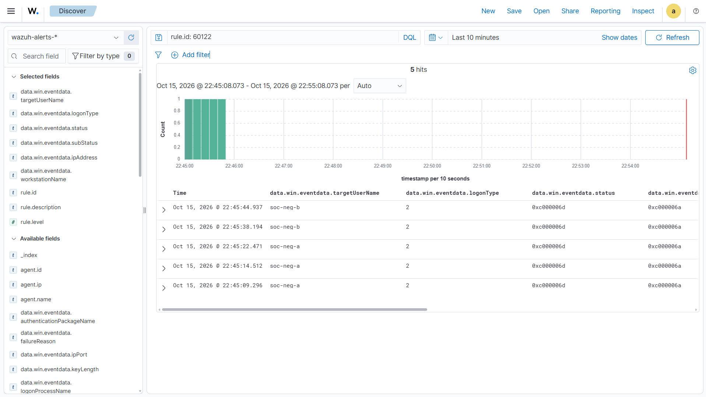
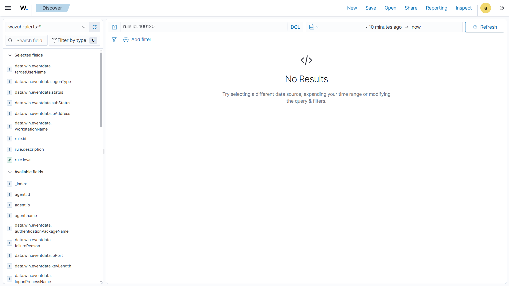

# D003 — Repeated Failed Windows Logons

## Overview

This detection identifies repeated failed Windows logon attempts targeting the same user account using Wazuh correlation rules.

The objective is to detect potential password guessing activity by correlating multiple Windows Security Event ID 4625 events within a defined time window.

## Detection Details

| Field | Value |
|---|---|
| Detection ID | D003 |
| Detection Name | Repeated Failed Windows Logons |
| Data Source | Windows Security Event Logs |
| Windows Event ID | 4625 |
| Wazuh Rule ID | 100120 |
| Base Rule | 60122 |
| Severity | Level 10 |
| Detection Type | Frequency-Based Correlation |
| MITRE ATT&CK | T1110.001 — Password Guessing |
| Status | Validated |

## Detection Logic

The rule detects five failed Windows logon attempts against the same target username within 120 seconds.

**Correlation conditions:**

- Base Wazuh Rule: `60122`
- Frequency: `5`
- Timeframe: `120 seconds`
- Correlation Field: `win.eventdata.targetUserName`

### Custom Wazuh Rule

```xml
<group name="local,windows_authentication,">

  <rule id="100120" level="10" frequency="5" timeframe="120">

    <if_matched_sid>60122</if_matched_sid>

    <same_field>win.eventdata.targetUserName</same_field>

    <description>Multiple failed Windows logons against the same user - Possible Password Guessing</description>

    <mitre>
      <id>T1110.001</id>
    </mitre>

    <group>authentication_failures,</group>

  </rule>

</group>
```

**Rule Location:** `/var/ossec/etc/rules/local_rules.xml`

## Existing Rule Investigation

Before creating the custom detection, existing Wazuh authentication rules were investigated.

| Rule ID | Description |
|---|---|
| 60122 | Single failed Windows logon |
| 60204 | Multiple authentication failures from the same source IP |
| 60203 | Multiple failed privileged operations by the same user |

The custom rule focuses on repeated authentication failures against the same target account rather than correlating events by source IP.

## Testing and Validation

### Test 1 — Positive Test

**Objective:** Verify that the rule triggers when five failed logon attempts target the same username within 120 seconds.

**Test Account:** `soc-lab`

**Method:** Generate failed authentication attempts using the Windows `runas` command with an incorrect password.

**Expected Result:** Wazuh generates an alert with Rule ID `100120`.

**Actual Result:** One Level 10 alert was generated.

**Status: PASS**



*Figure 1 — Custom correlation rule 100120 successfully triggered.*

### Test 2 — Negative Test

**Objective:** Verify that failed logon attempts targeting different accounts do not trigger the correlation rule when neither account reaches the threshold.

| Target Username | Failed Attempts |
|---|---:|
| soc-neg-a | 3 |
| soc-neg-b | 2 |
| Total | 5 |

**Expected Result:** Five individual failed logon alerts, with no new Rule 100120 alert.

**Actual Result:**

- Five alerts were recorded under Rule `60122`.
- No Rule `100120` alert was generated during the negative-test window.

**Status: PASS**



*Figure 2 — Five failed logon events distributed across two accounts.*



*Figure 3 — No custom correlation alert generated during the negative test.*

## Windows Event Analysis

| Field | Observed Value |
|---|---|
| Event ID | 4625 |
| Logon Type | 2 — Interactive |
| Status | 0xc000006d |
| SubStatus | 0xc000006a |
| Source IP | ::1 |
| Workstation | SOC-WINDOWS |

The events were generated locally on the Windows endpoint. The IPv6 loopback address `::1` indicates local authentication activity rather than a confirmed remote attack.

## False Positives and Limitations

Repeated failed authentication attempts may be caused by forgotten passwords, outdated credentials, or application misconfigurations.

The detection correlates failures targeting the same username on the same Wazuh agent. It does not require a specific source IP or logon type.

Slow password guessing attempts below the configured threshold may not trigger the rule. An alert should therefore be investigated before concluding that malicious activity occurred.

## SOC Investigation Recommendations

When the detection triggers, the analyst should investigate:

- Target username and affected endpoint
- Source IP address and workstation
- Logon type and authentication failure codes
- Number and timing of failed attempts
- Successful logons occurring before or after the failures
- Whether the activity matches expected user behavior

## Lessons Learned

- Investigated existing Wazuh authentication rules before creating a custom detection.
- Learned the difference between atomic and correlation detections.
- Implemented correlation using `if_matched_sid`, `frequency`, `timeframe`, and `same_field`.
- Successfully validated the rule using positive and negative tests.
- Identified potential false positives and detection limitations.
- Mapped the detection to MITRE ATT&CK T1110.001.

## Final Result

**D003 successfully detected repeated failed Windows logons against the same account while avoiding an alert when the tested failures were distributed across different accounts.**

**Detection Status: VALIDATED**
