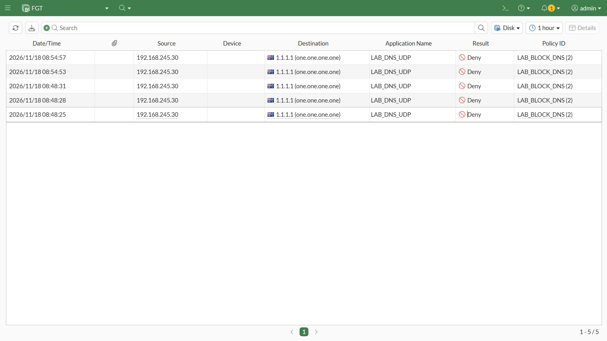
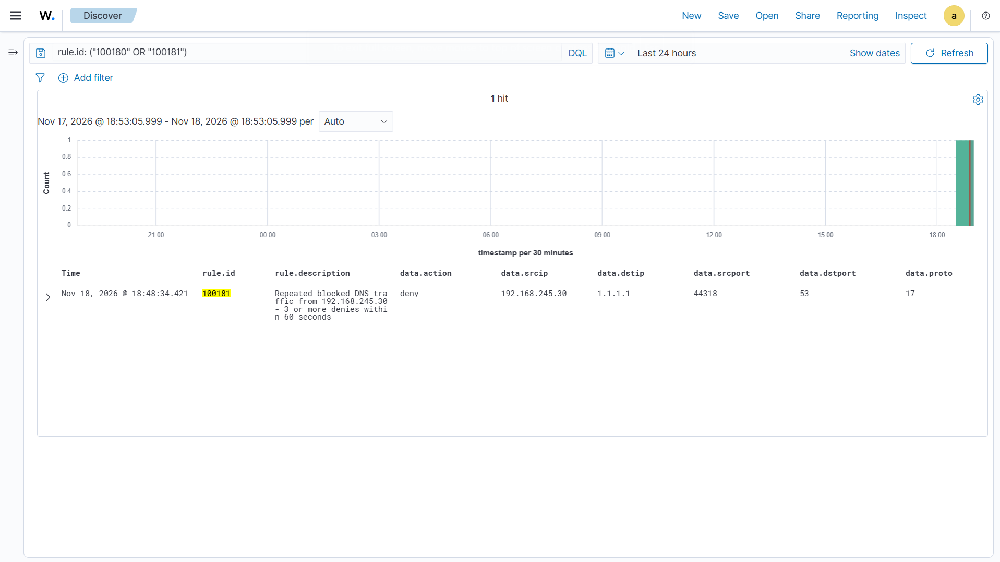

# D009 — Repeated Blocked DNS Traffic

| Field | Details |
|---|---|
| Detection ID | D009 |
| Wazuh rules | **100180** (base), **100181** (behavioral correlation) |
| Data source | FortiGate forward-traffic Syslog |
| Platform | FortiGate 7.6.8 / Wazuh 4.14.8 |
| Severity | **Level 8** for correlated activity (`100181`) |
| Parent Wazuh rule | **81618** — `Fortigate: Traffic to be aware of.` |
| Decoder | `fortigate-firewall-v5` |
| Validation | Positive and negative tests completed on **November 18, 2026** |
| MITRE ATT&CK | **Not mapped from this evidence alone** |
| Status | **Validated in isolated SOC lab** |

## Detection Objective

Detect repeated **blocked DNS over UDP** attempts from the same source IP within a short period, rather than alerting on every individual firewall deny.

The detection is intentionally descriptive. Three blocked DNS attempts do **not** establish DNS tunneling, malware activity, command-and-control, or malicious intent. The alert is a triage signal that tells the analyst that one host repeatedly attempted DNS traffic that the firewall denied.

## Log Collection Path

The FortiGate was integrated with Wazuh using a staged log pipeline so collection, ingestion, decoding, and alerting could be validated separately:

```text
FortiGate 192.168.245.40
        |
        | Syslog over TCP/514
        v
rsyslog on Wazuh Server 192.168.245.10
        |
        | raw FortiGate events
        v
/var/log/fortigate/traffic.log
        |
        | Wazuh logcollector
        v
fortigate-firewall-v5 decoder
        |
        v
Wazuh rules engine
```

The FortiGate source IP used for Syslog transport is `192.168.245.40`. This must not be confused with the traffic source inside the firewall event, such as `srcip=192.168.245.30`.

Before writing custom rules, a real denied DNS event was verified at each stage:

- FortiGate Forward Traffic showed the deny.
- `rsyslog` wrote the same event to `/var/log/fortigate/traffic.log`.
- `wazuh-logtest` decoded the event with `fortigate-firewall-v5`.
- Wazuh automatically ingested the event from the monitored file.
- Built-in Wazuh rule `81618` matched the traffic event at level 1.

## Rule Logic

| Rule | Role | Logic |
|---|---|---|
| **100180** | Base match; level **1** | Child of `81618`; matches `action=deny`, `proto=17` (UDP), and destination port `53`. Uses `no_log` to avoid alerting on each individual deny. |
| **100181** | Correlated alert; level **8** | Requires prior `100180` matches; `frequency="3"` within `timeframe="60"` seconds; groups by the same source IP using `same_srcip`; suppresses repeated alerts for 60 seconds after firing. |

### Installed Wazuh Rule Configuration

Both rules are stored in the existing `/var/ossec/etc/rules/local_rules.xml`.

```xml
<!-- D009: Repeated FortiGate Blocked DNS Traffic -->
<group name="local,fortigate,network_security,dns_monitoring,">

  <!-- Base: single blocked DNS/UDP connection -->
  <rule id="100180" level="1">
    <if_sid>81618</if_sid>

    <action>deny</action>
    <field name="proto" type="pcre2">^17$</field>
    <dstport type="pcre2">^53$</dstport>

    <description>FortiGate blocked DNS/UDP traffic from $(srcip) to $(dstip)</description>

    <options>no_log</options>

    <group>firewall_deny,dns_blocked,</group>
  </rule>

  <!-- Correlation: repeated DNS blocks from the same source -->
  <rule id="100181" level="8" frequency="3" timeframe="60" ignore="60">
    <if_matched_sid>100180</if_matched_sid>

    <same_srcip />

    <description>Repeated blocked DNS traffic from $(srcip) - 3 or more denies within 60 seconds</description>

    <group>firewall_deny,repeated_dns_blocked,</group>
  </rule>

</group>
```

The base rule remains level 1 because Wazuh frequency correlation needs a non-zero rule for `if_matched_sid`. The `no_log` option prevents individual base matches from flooding the alert index while still allowing `100181` to correlate them.

## Validation

### Unit Test — Positive Correlation

A real FortiGate DNS-deny log was submitted three times in one `wazuh-logtest` session.

**Expected:** rule `100181` fires after the third event.

**Observed:**

```text
Rule ID:      100181
Level:        8
Frequency:    3
Source IP:    192.168.245.30
Description:  Repeated blocked DNS traffic from 192.168.245.30 - 3 or more denies within 60 seconds
```

**Status: PASS**

### Unit Test — Source-IP Grouping

The test used two events from `192.168.245.30` and one synthetically modified event from `192.168.245.31`.

**Expected:** no `100181` alert because no single source reached the threshold.

**Observed:** the base rule `100180` matched, but `100181` did not fire.

**Status: PASS**

This verifies that `same_srcip` prevents unrelated hosts from being combined into one correlation count.

### Live Positive Test

Kali Linux (`192.168.245.30`) generated three authorized DNS queries to `1.1.1.1:53/UDP`. FortiGate policy `LAB_BLOCK_DNS (2)` denied all three.

Observed FortiGate events occurred at:

```text
08:48:25  deny
08:48:28  deny
08:48:31  deny
```

The three events triggered Wazuh rule `100181` at level 8.



*Figure 60. FortiGate Forward Traffic shows the three-event positive test at 08:48:25–08:48:31 and the later two-event negative test at 08:54:53–08:54:57.*



*Figure 61. Wazuh rule 100181 generated one Level 8 alert for repeated blocked DNS traffic from 192.168.245.30 to 1.1.1.1 over UDP/53.*

**Status: PASS**

### Live Negative Test

After the positive-test correlation window, Kali generated only two DNS queries matching the same blocked traffic pattern.

FortiGate recorded:

```text
08:54:53  deny
08:54:57  deny
```

No new `100181` alert appeared in `alerts.json`.

**Status: PASS**

## Example Event Fields

The FortiGate decoder extracted fields used for detection and investigation, including:

```text
srcip=192.168.245.30
dstip=1.1.1.1
dstport=53
proto=17
action=deny
policyid=2
policyname=LAB_BLOCK_DNS
service=LAB_DNS_UDP
```

The rule does not depend on `policyid=2`; it detects the defined blocked DNS/UDP pattern even if firewall policy numbering changes.

## Analyst Triage Guidance

When `100181` fires, the analyst should verify:

- Source IP and affected host identity.
- Destination IP and whether the DNS destination is expected.
- Number and timing of deny events.
- FortiGate policy name and interfaces involved.
- Whether other DNS servers or destination ports were attempted.
- Endpoint telemetry showing which process generated the network activity, if available.
- Whether the behavior matches an authorized test, application misconfiguration, hard-coded DNS configuration, or other expected activity.
- Whether related security events provide evidence of malicious behavior.

The alert should not be escalated as DNS tunneling or malware solely because the threshold was reached.

## False Positives, Gaps, and Tuning

- **Potential benign causes:** manually configured public DNS, an application with a hard-coded resolver, retry behavior, or an authorized test.
- **Threshold limitation:** activity below three events in 60 seconds is not detected by `100181`.
- **Protocol limitation:** the current base rule covers UDP/53. DNS over TCP, DNS over TLS, DNS over HTTPS, and other resolver behavior are outside this rule.
- **Intent limitation:** firewall denies show attempted traffic and enforcement, not why the host attempted it.
- **Source identity limitation:** the rule groups by source IP. DHCP reassignment, NAT, or shared source addresses can affect attribution in other environments.
- **Telemetry dependency:** if FortiGate Syslog collection stops, the detection becomes blind even though the firewall may continue enforcing the policy.

Tuning should be based on observed normal traffic. Thresholds and exclusions should be adjusted only after validating legitimate workflows rather than suppressing broad categories of firewall events.

## Detection Assessment

**Verdict:** **True positive for the authorized repeated blocked-DNS activity simulated in the lab.**

The test proves that FortiGate deny events are collected, decoded, correlated by source IP, and promoted to a Level 8 Wazuh alert when the tested threshold is reached. It does **not** prove malware infection, DNS tunneling, command-and-control, or compromise.

## Lessons Learned

- Validate the full log pipeline before changing detection logic.
- Distinguish **log collection**, **decoding**, **rule matching**, and **alert generation** as separate stages.
- Reuse the existing FortiGate decoder instead of creating an unnecessary custom decoder.
- Use a low-level `no_log` base rule to support behavioral correlation without alert flooding.
- Test both positive and negative cases before marking a rule as validated.
- Describe only what the evidence proves; repeated firewall denies are a triage signal, not a malicious verdict.

## Final Result

**D009 successfully detected three blocked DNS/UDP attempts from the same source within 60 seconds while producing no correlated alert for the tested two-event case or for events split across different source IPs.**

**Detection Status: VALIDATED**
