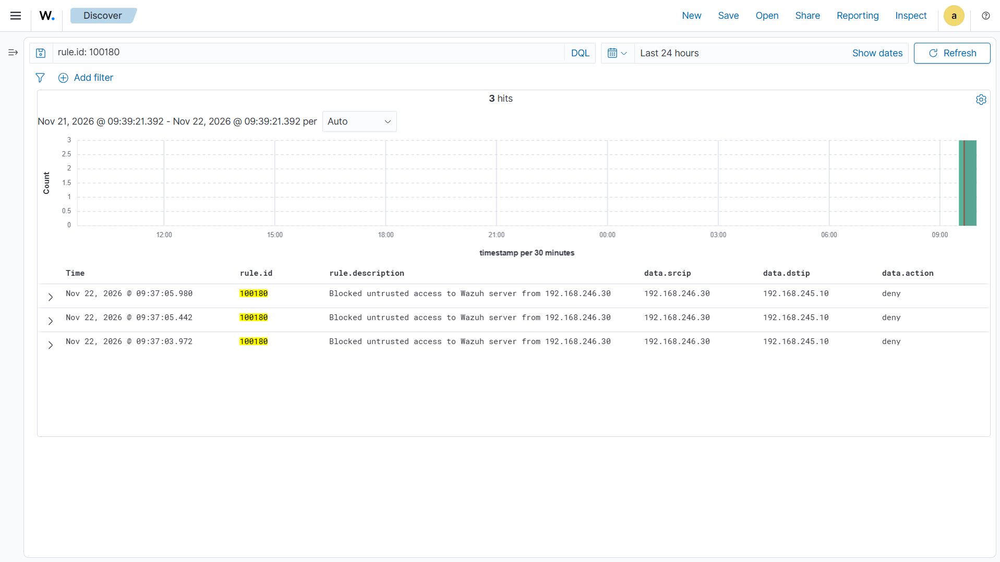
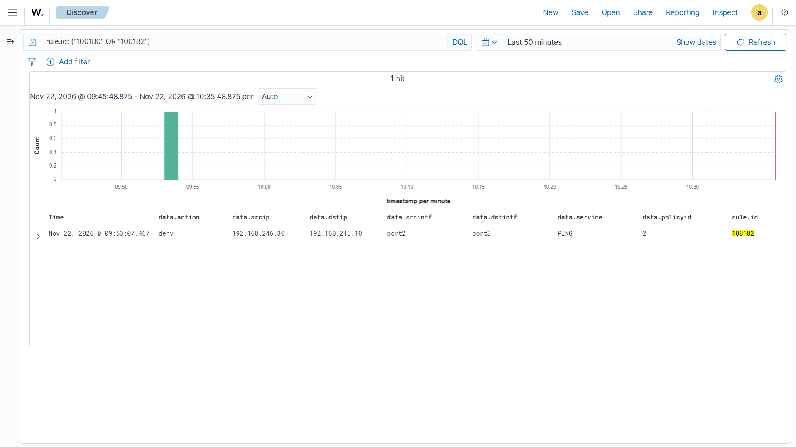

# D009 — Untrusted Access to Wazuh Server

| Field | Details |
|---|---|
| Detection ID | D009 |
| Wazuh rules | **100180** (base denied event), **100181** (successful untrusted access), **100182** (repeated denied-access correlation) |
| Data source | FortiGate forward-traffic syslog decoded by `fortigate-firewall-v5` |
| Platform | FortiGate FortiOS 7.6.8 evaluation VM / Wazuh 4.14.8 |
| Protected asset | Wazuh server `192.168.245.10` |
| Trusted SOC network | `192.168.245.0/24` |
| Severity | **Level 8** for repeated denied access; **Level 12** for successful untrusted access |
| Validation | Syntax, decoder, positive, negative, correlation, and live denied-access tests completed November 22, 2026 |
| Status | **Validated in isolated SOC lab** |

## Detection Objective

Detect access to the Wazuh server from a source **outside the trusted SOC subnet**, while distinguishing between:

1. a single connection attempt that the firewall blocked,
2. repeated blocked attempts from the same source, and
3. an untrusted connection that the firewall actually accepted.

The detection intentionally does **not** depend on the Kali host, a specific attack-zone interface, ICMP, or a single firewall policy name. The security boundary is the source trust relationship: traffic is considered untrusted when the decoded source IP is not within `192.168.245.0/24`.

This makes the detection logic portable in concept: in a production network, the trusted CIDR and protected SIEM addresses would be replaced with the organization's real management/SOC networks and assets.

## Telemetry Pipeline

FortiGate logs are collected through the following path:

```text
FortiGate
   |
   | Syslog TCP/514
   v
rsyslog collector on Wazuh
   |
   v
/var/log/fortigate/traffic.log
   |
   v
Wazuh logcollector
   |
   v
fortigate-firewall-v5 decoder
   |
   v
Local detection rules
```

The live test confirmed that the decoder extracted fields including:

```text
srcip=192.168.246.30
srcintf=port2
dstip=192.168.245.10
dstintf=port3
action=deny
service=PING
policyid=2
```

Before the custom rule was applied, the same event matched built-in Wazuh rule **81618**, `Fortigate: Traffic to be aware of.`, at level 1.

## Rule Logic

| Rule | Role | Logic |
|---|---|---|
| **100180** | Base denied event; level **1** | Parent rule `81618`; `action=deny`; source is **not** in `192.168.245.0/24`; destination is `192.168.245.10`. Uses `no_log` so individual denied packets do not flood alerts. |
| **100181** | Successful untrusted access; level **12** | Parent rule `81618`; `action=accept`; source is **not** in `192.168.245.0/24`; destination is `192.168.245.10`. Generates an immediate high-severity alert. |
| **100182** | Behavioral correlation; level **8** | Requires **3** matches of `100180` within **60 seconds** from the **same source IP**. |

### Installed Wazuh Rule Configuration

These rules belong together in the existing `/var/ossec/etc/rules/local_rules.xml` file.

```xml
<!-- D009: Untrusted Access to Wazuh Server -->
<group name="local,fortigate,network_security,soc_protection,">

  <!-- Base event: blocked untrusted access -->
  <rule id="100180" level="1">
    <if_sid>81618</if_sid>
    <action>deny</action>

    <srcip negate="yes">192.168.245.0/24</srcip>
    <dstip>192.168.245.10</dstip>

    <description>Blocked untrusted access to Wazuh server from $(srcip)</description>
    <options>no_log</options>

    <group>firewall_deny,soc_asset_access,untrusted_source,</group>
  </rule>

  <!-- Successful access: immediate high-severity alert -->
  <rule id="100181" level="12">
    <if_sid>81618</if_sid>
    <action>accept</action>

    <srcip negate="yes">192.168.245.0/24</srcip>
    <dstip>192.168.245.10</dstip>

    <description>Successful untrusted access to Wazuh server from $(srcip)</description>

    <group>firewall_accept,soc_asset_access,untrusted_source,</group>
  </rule>

  <!-- Repeated blocked attempts -->
  <rule id="100182" level="8" frequency="3" timeframe="60">
    <if_matched_sid>100180</if_matched_sid>
    <same_srcip />

    <description>Repeated blocked access attempts to Wazuh server from untrusted source $(srcip)</description>

    <group>firewall_deny,soc_asset_access,repeated_untrusted_access,</group>
  </rule>

</group>
```

## Why the Base Rule Does Not Alert

An earlier live version of rule `100180` was level 6 and generated one alert per denied packet. A three-packet ping test therefore produced three alerts.

The rule was tuned to **level 1 + `no_log`**, with `100182` performing behavioral correlation. After tuning, the same three denied attempts produced **one level-8 correlated alert** instead of three separate alerts.

This preserves the event state needed for correlation while reducing alert noise.



*Figure 60. Before correlation tuning, three blocked packets generated three separate rule `100180` alerts, demonstrating unnecessary packet-level alert noise.*

## Validation Results

| Test | Procedure / observation | Result |
|---|---|---|
| Configuration validation | `wazuh-analysisd -t` after editing `local_rules.xml`. | **Exit code 0** |
| Decoder validation | A real FortiGate deny log was submitted to `wazuh-logtest`. | **Decoded by `fortigate-firewall-v5`** |
| Denied-access positive test | Untrusted source `192.168.246.30` -> Wazuh `192.168.245.10`, `action=deny`. | **100180 matched** |
| Successful-access synthetic test | Same decoded event changed to `action=accept` inside `wazuh-logtest`. | **100181 / Level 12 matched** |
| Trusted-source negative test | Source changed to `192.168.245.20`, inside trusted `192.168.245.0/24`. | **D009 did not match; event remained at built-in rule 81618** |
| Correlation test | Same denied event submitted three times in one `wazuh-logtest` session. | **100182 / Level 8 matched at frequency 3** |
| Live validation | Kali generated three real denied ICMP attempts to the Wazuh server after Wazuh Manager restart. | **One live 100182 alert indexed in Wazuh Discover** |

### Live Correlated Alert

Observed in `/var/ossec/logs/alerts/alerts.json` and Wazuh Discover:

```text
Rule ID:      100182
Level:        8
Source:       192.168.246.30
Destination:  192.168.245.10
Action:       deny
Description:  Repeated blocked access attempts to Wazuh server from untrusted source 192.168.246.30
Frequency:    3
```

The contributing FortiGate traffic events showed `srcintf=port2`, `dstintf=port3`, `policyid=2`, and `action=deny`.



*Figure 61. After tuning, three blocked attempts from the same untrusted source generated one Level 8 correlated `100182` alert. The indexed event shows the source and destination IPs, FortiGate interfaces, denied action, service, and policy ID.*

## Important Validation Boundary

Rule **100181** was validated with a **synthetic `wazuh-logtest` event only**. The lab did **not** intentionally open Wazuh access from the untrusted network merely to create a live successful-access alert.

Therefore:

- `100180`: positive rule test completed; live base events contributed to correlation.
- `100181`: positive synthetic rule test completed; **not live-tested**.
- `100182`: positive correlation test and **live end-to-end validation completed**.
- trusted-source exclusion: negative test completed.

## Production Relevance and Limitations

- **Trust boundaries must be environment-specific.** A real organization may have multiple trusted management, VPN, monitoring, or jump-host networks. Those ranges must be modeled explicitly.
- **The rule detects only traffic visible to FortiGate.** If an attacker bypasses the firewall path entirely, there is no FortiGate event for these rules to analyze. Host-based Wazuh telemetry and other network controls are still required.
- **An accepted firewall connection is not proof of compromise.** Rule `100181` indicates a security-boundary violation or unexpected successful reachability and requires investigation.
- **A denied connection is not proof of malicious intent.** Repeated denies can result from scans, misconfiguration, monitoring errors, or stale infrastructure.
- **The protected destination is currently a single lab IP.** Production deployment should use managed asset/network definitions that reflect the actual SIEM infrastructure.
- **Correlation threshold is a tuning choice.** Three denied attempts within 60 seconds worked for this lab; production thresholds should be based on baseline traffic and acceptable alert volume.

## Analyst Triage

For a `100182` or `100181` alert:

1. Identify the source asset and whether it belongs to an approved network or administrator.
2. Review `data.action`, `data.srcip`, `data.dstip`, `data.srcintf`, `data.dstintf`, `data.service`, and `data.policyid`.
3. Pivot to the raw FortiGate traffic events around the alert time.
4. For an accepted connection, review host-based Wazuh logs on the protected server for authentication, process, web, SSH, and other relevant telemetry.
5. Determine whether the event represents expected administration, a firewall-policy error, reconnaissance, or a genuine access attempt.

## Detection Assessment

**Verdict:** The detection correctly identifies repeated firewall-blocked access to the Wazuh server from outside the trusted SOC subnet and suppresses packet-level alert noise through correlation. It also contains a separate high-severity rule for accepted untrusted traffic.

The live lab evidence validates the denied-access correlation path end to end. It does **not** claim that a live firewall bypass or successful compromise was performed.

## Related Architecture

- [SOC Home Lab Architecture](/architecture/lab-overview.md)
